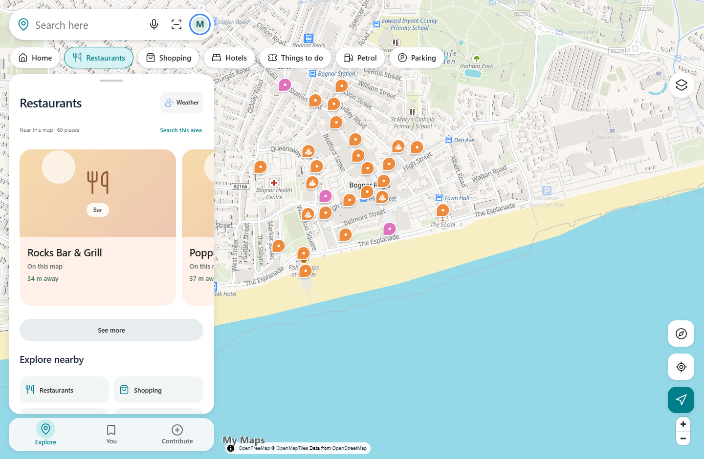

<p align="center"></p>

# My Maps

Explore the world from One Workspace. A portable Windows **Maps.exe** with the
Workspace design system, MyAccounts sign-in, saved places and open-data directions.
Built on [MapLibre](https://maplibre.org/), OpenFreeMap and OpenStreetMap, without a paid API key.



## Use it

Download the Windows ZIP from [Releases](https://github.com/oneworkspacestudio/my-maps/releases),
extract it into a dedicated NTFS folder and run **Maps.exe**. Its browser opens a
one-time local owner setup. No Docker, Node or Go installation is needed.

One Workspace installs the app automatically at `/maps/`, configures MyAccounts,
and stores its private state in the Workspace data folder under `maps`.
An existing Workspace login starts the normal authenticated SSO flow automatically.
Standalone accounts are disabled in managed mode.

## Included

- Full-screen vector map with floating search, category chips, a sliding place sheet,
  Explore / You / Contribute tabs and an account menu.
- Interactive street map, zoom, rotation, location and dropped pins.
- Nearby restaurants, shopping, hotels, attractions, parking and fuel.
- Map-type and detail picker, raised buildings and open terrain.
- Regional NASA satellite imagery (500 m resolution), local weather and modelled air quality.
- Public transport and cycling facilities; links to community street imagery and NASA fires.
- Browser voice search where supported, and exact-coordinate search.
- Place/address search and reverse lookup, only when requested.
- Private saved lists, notes, favourites and deletion.
- Share links containing a place name and coordinates, without private notes.
- Driving, cycling and walking directions, up to eight stops, alternatives,
  distance/time estimates and written route steps.
- Follow your location and measure distances.
- GeoJSON saved-place and GPX route downloads.
- Light/dark theme, mobile layout, Workspace launcher, encrypted backups.

## Open services and limits

The default vector map uses [OpenFreeMap](https://openfreemap.org/quick_start/),
[OpenMapTiles](https://openmaptiles.org/) and OpenStreetMap. Terrain comes from
[Mapterhorn](https://mapterhorn.com/attribution); regional imagery comes from
[NASA GIBS](https://nasa-gibs.github.io/gibs-api-docs/). Attribution stays visible.
There are no offline downloads or tile prefetch jobs. Map resources pass through
an authenticated, fixed-provider relay; provider credentials are never forwarded.

[Photon](https://github.com/komoot/photon) provides address search,
[FOSSGIS OSRM](https://routing.openstreetmap.de/about.html) provides routes, and
Overpass provides nearby place details. User-triggered requests are rate limited
server-wide and cached for 24 hours. If Overpass is unavailable, the app can show
places in the loaded vector tiles, with a notice that full details are unavailable.
Weather and air quality use [Open-Meteo](https://open-meteo.com/), cached for
15 minutes. Its free service is for personal/non-commercial installations;
[provider terms](https://open-meteo.com/en/terms) apply. All public providers are
best effort and can restrict usage.

Search text and requested coordinates go to the selected providers. Location is
requested only when you press My location or Follow my location. Saved places
and notes stay on your server. Voice search uses your browser's speech service
when available; its microphone permission is requested only after your action.

The layout follows the supplied Google Maps references, but this release does
**not provide full Google Maps feature parity**. There is no Google place-photo,
review or rating feed, Lens, live traffic, transit timetable, cycle-network overlay,
embedded Street View, live fire overlay, background navigation, voice guidance
or offline map package. Street imagery and fire maps open separate services.
Satellite imagery is regional NASA Blue Marble, not street-resolution imagery.
Raised buildings depend on mapped heights. Location following is not turn-by-turn
navigation. Routes exclude live congestion and road closures.

Administrators can use `MYMAPS_GEOCODER` (Photon HTTPS base), `MYMAPS_ROUTER`
(FOSSGIS-compatible base) and `MYMAPS_OVERPASS` (HTTPS base). Existing `MYMAPS_TILES`
XYZ URLs remain supported as the Default raster map; `MYMAPS_TILE_ATTRIBUTION`
sets their attribution. Terrain and raised buildings use the open vector data.
Use suitably provisioned or self-hosted services for larger installations.
See [capability details](docs/FEATURES.md).

## Build

Go 1.27.2, Node 26, PowerShell 7:

```powershell
./scripts/build.ps1 -Go go -Npm npm.cmd -Output ./dist
```

Screens are authored in `web/src/screens/*.aui`; `npm run build` regenerates React.
Release binaries are built locally, with dependency licences and source receipts.
No GitHub Actions. Application code is Apache-2.0; see `NOTICE`, `SECURITY.md` and the
third-party licence bundle. This project is not affiliated with Google.
