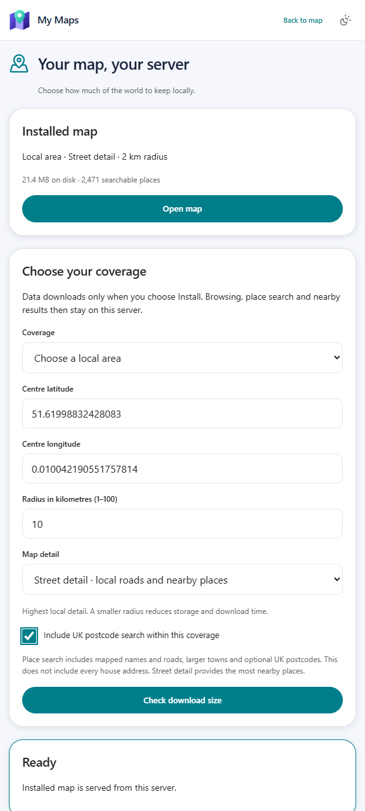
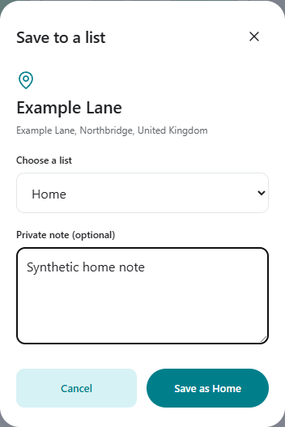

<p align="center"></p>

# My Maps

Keep your maps and places on your own server. Choose a small world overview,
regional detail or a local street map, then browse and search that downloaded data
without a public map service or Google data.

Download the Windows ZIP from [Releases](https://github.com/oneworkspacestudio/my-maps/releases),
extract it into a dedicated NTFS folder and run **Maps.exe**. A browser opens for
local owner setup. One Workspace installs it at `/maps/` with MyAccounts sign-in.
No Node, Go or Docker installation is required to run Maps.

## Choose your map

The first screen asks the server owner to choose coverage and detail. Other users
share that map and keep their own saved places and recent searches private.
You can change coverage later through **Map downloads** (the download icon on
the map or the account menu).

- **Overview:** the smallest level, with towns and main roads; available worldwide.
- **Regional:** more roads and place names across the UK, Europe or a local area.
- **Streets:** local roads and nearby places for an area with a 1–100 km radius.
- **UK postcodes:** an optional search index within the chosen coverage.

Check the download size before installing. The screen also shows the free space
needed for indexing and safe replacement. Oversized choices are rejected with
smaller-area guidance. Downloads are optional; updating the app does not download
an entire country. Each server chooses its own coverage. A previous map remains
available during installation or cancellation.



## Explore and save

Use full-screen search, recent places, Home/Work shortcuts, category chips and
exact coordinates. Searching selects a place with a compact sheet, keeping the
map visible. Drag or tap the handle to open details. Save private lists and notes,
share coordinates without notes, export places as GeoJSON and measure distances.
Maps works without WebGL and offers light/dark appearance, Workspace navigation
and encrypted backups.

Nearby results come from the installed map. Coverage and detail affect what is
searchable; this includes mapped names, roads, larger towns and selected UK
postcodes, rather than every house address.

## Directions out of the box

Every place has **Directions** and **Start**. UK and local-area map setup includes
local driving, walking and cycling directions by default. Choose coverage, check
the download size and install. Maps downloads and manages its own local engine;
no Java, Docker, API key or manual routing URL is needed. Existing servers can add
it under **Map downloads → Local directions**.

Choose Drive, Walk or Cycle. Car types include petrol/diesel, electric and hybrid;
bicycle profiles include touring, road, gravel and mountain bike. Walking also
offers hiking. Car options include fastest/lower-energy routing and avoiding tolls,
motorways or unpaved roads. Previews show time, distance, alternatives and turns.
Add up to eight stops, share their coordinates or export GPX. Start shows the next
turn and remaining distance using device location while the page is open. If you
leave the route, update directions from your current location.

Routes are calculated on your server from downloaded OpenStreetMap-derived data.
Five-degree data tiles may extend beyond the selected radius. A private loopback
adapter isolates the downloaded engine, which exits with Maps. Precise route
requests and GPS positions are not logged or saved. Engine licences and pinned
download hashes are in `docs/licenses/directions-sources.json`; installed runtimes
preserve their complete `legal/` directory. Downloaded coverage can be reinstalled
after restoring an app backup.

Estimates exclude live traffic and closures. Public transport, charging stops,
vehicle height/weight restrictions and Google photos/reviews are unavailable.
Electric/hybrid types adjust an energy model, without predicting battery range.
Turn cues do not announce street names. Legacy loopback OSRM remains available
through the existing API for standard driving only.

## Save a place or set Home

Tap **Save** on a location or a search/nearby result. Choose **Favourites**, **Home**,
**Work** or an existing list from the dropdown, then confirm. Create a new list in
that same picker if needed. Private notes are optional. Opening or cancelling the
picker makes no changes.

An unset Home or Work shortcut opens search and preselects the right list after
you choose a location. A configured shortcut opens its place. Replacing Home or
Work moves the previous location to Favourites and keeps its notes.



## Data and privacy

[OpenStreetMap](https://www.openstreetmap.org/copyright) / [Protomaps](https://docs.protomaps.com/basemaps/downloads)
provide the downloadable map, and [GeoNames](https://www.geonames.org/export/)
provides town names and optional UK postcodes. These sources are contacted when
you check and install a download. Map browsing, search and nearby results then
use files and an index on your server, with no public fallback. Attribution and
[data licences](docs/DATA-LICENSES.md) apply. Private places and history remain
account-isolated. Device location is requested only by explicit location actions.

Maps does not use Google APIs or My AI's web-search engine. Workspace My Search
indexes private app content; geographic search uses the installed map index.
Unsupported imagery, terrain/3D, weather, traffic, Street View, voice/Lens,
ratings/photos/reviews and live transit controls are removed. The supplied Google
Maps images inform the layout; full feature parity is not claimed.

See [capabilities and local-service setup](docs/FEATURES.md) and
[verification limits](docs/ACCEPTANCE.md). Managed updates require Workspace92+.

## Build

Go 1.27.3, Node 26, PowerShell 7:

```powershell
./scripts/build.ps1 -Go go -Npm npm.cmd -Output ./dist
```

Screens are authored in `web/src/screens/*.aui`; `npm run build` regenerates React.
Release binaries are built locally, with dependency licences and source receipts.
No GitHub Actions. Application code is Apache-2.0; see `NOTICE`, `SECURITY.md` and the
third-party licence bundle. This project is not affiliated with Google.
