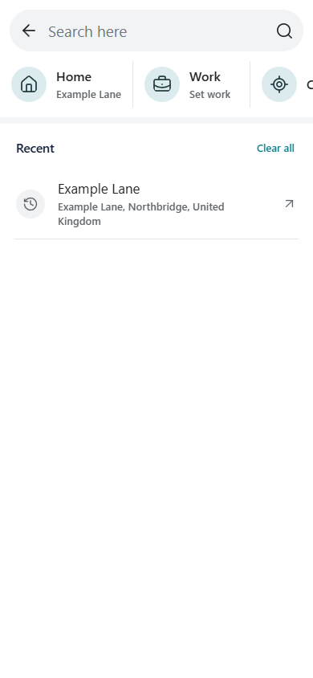
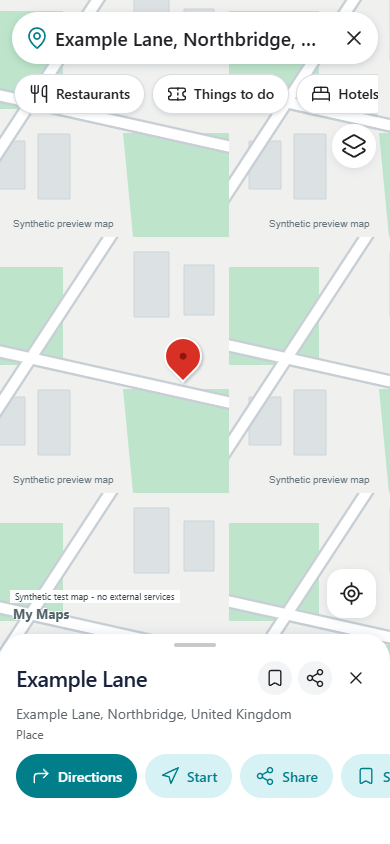

<p align="center"></p>

# My Maps

Explore the world from One Workspace. A portable Windows **Maps.exe** with the
Workspace design system, MyAccounts sign-in, saved places and open-data directions.
Built on [MapLibre](https://maplibre.org/), OpenFreeMap and OpenStreetMap, without a paid API key.


## Use it

Download the Windows ZIP from [Releases](https://github.com/oneworkspacestudio/my-maps/releases),
extract it into a dedicated NTFS folder and run **Maps.exe**. Its browser opens a
one-time local owner setup. No Docker, Node or Go installation is needed.

One Workspace installs the app automatically at `/maps/`, configures MyAccounts,
and stores its private state in the Workspace data folder under `maps`.
An existing Workspace login starts the normal authenticated SSO flow automatically.
Standalone accounts are disabled in managed mode. This managed update requires
Workspace 0.3.0-preview.92 or newer.

## Included

The mobile search/place revision below is working source, not a new public release.
Existing installations remain on preview.8 until a subsequent verified update.

<p> </p>

These UI previews use synthetic test data.

- Full-screen map with floating search, category chips, a sliding place sheet,
  Explore / You / Contribute tabs and an account menu.
- Full-screen search with address suggestions, private recent searches and Home/Work shortcuts.
- Compact place actions: Directions, Start, Save and Share before opening details.
- Interactive street map, zoom, rotation, location and dropped pins.
- Nearby restaurants, shopping, hotels, attractions, parking and fuel.
- Map-type and detail picker, raised buildings and open terrain.
- Regional NASA satellite imagery (500 m resolution).
- Nearby transport stops and cycling facilities.
- Exact-coordinate search.
- Place/address search and reverse lookup, when you type or submit a search, or choose a map point.
- Private saved lists, notes, favourites and deletion.
- Share links containing a place name and coordinates, without private notes.
- Driving, cycling and walking directions, up to eight stops, alternatives,
  distance/time estimates and written route steps.
- Follow your location and measure distances.
- GeoJSON saved-place and GPX route downloads.
- Light/dark theme, mobile layout, Workspace launcher, encrypted backups.

## Open services and limits

**Current hosting boundary:** the application and private places are self-hosted,
but the default map, address and routing providers below are public services.
This is not yet a fully self-hosted map stack. The self-hosting correction is
in progress; geographic coverage must be selected before provisioning local data.
My Search federates private Workspace content, while My AI includes SearXNG web
search. Neither replaces a geographic index or routing graph. The bundled My AI
search configuration currently includes Google; Maps does not use it.

Phones use OpenStreetMap image tiles without requiring graphics acceleration. Desktop vector maps use [OpenFreeMap](https://openfreemap.org/quick_start/),
[OpenMapTiles](https://openmaptiles.org/) and OpenStreetMap. Terrain comes from
[Mapterhorn](https://mapterhorn.com/attribution); regional imagery comes from
[NASA GIBS](https://nasa-gibs.github.io/gibs-api-docs/). Attribution stays visible.
There are no offline downloads or tile prefetch jobs. Map resources pass through
an authenticated, fixed-provider relay; provider credentials are never forwarded.

[Photon](https://github.com/komoot/photon) provides address search,
[FOSSGIS OSRM](https://routing.openstreetmap.de/about.html) provides routes, and
Photon also provides nearby category search on phones and desktops, with Overpass
as a backup. Address/route queries are cached for 24 hours, nearby queries for
one hour. New provider requests wait at a server-wide one-per-second limit.
A loaded-vector fallback remains available when both nearby providers fail.
All public providers are best effort and can restrict usage.

Search text and requested coordinates go to the selected providers. Location is
requested only when you press My location or Follow my location. Saved places
and notes stay on your server. Browser cloud speech recognition is removed.

The layout follows the supplied Google Maps references, but this release does
**not provide full Google Maps feature parity**. There is no Google place-photo,
review or rating feed, Lens, live traffic, transit timetable, cycle-network overlay,
embedded Street View, live fire overlay, background navigation, voice guidance
or offline map package. Unavailable traffic, street-imagery and fire controls
are removed, along with external weather and air-quality calls.
Satellite imagery is regional NASA Blue Marble, not street-resolution imagery.
Raised buildings depend on mapped heights. Location following is not turn-by-turn
navigation. Routes exclude live congestion and road closures.

Administrators can use `MYMAPS_GEOCODER` (Photon HTTPS base), `MYMAPS_ROUTER`
(FOSSGIS-compatible base) and `MYMAPS_OVERPASS` (HTTPS base). Existing `MYMAPS_TILES`
XYZ URLs remain supported as the Default raster map; `MYMAPS_TILE_ATTRIBUTION`
sets their attribution. Terrain and raised buildings use the open vector data.
Use suitably provisioned or self-hosted services for larger installations.
See [capability details](docs/FEATURES.md).

## Build

Go 1.27.3, Node 26, PowerShell 7:

```powershell
./scripts/build.ps1 -Go go -Npm npm.cmd -Output ./dist
```

Screens are authored in `web/src/screens/*.aui`; `npm run build` regenerates React.
Release binaries are built locally, with dependency licences and source receipts.
No GitHub Actions. Application code is Apache-2.0; see `NOTICE`, `SECURITY.md` and the
third-party licence bundle. This project is not affiliated with Google.
